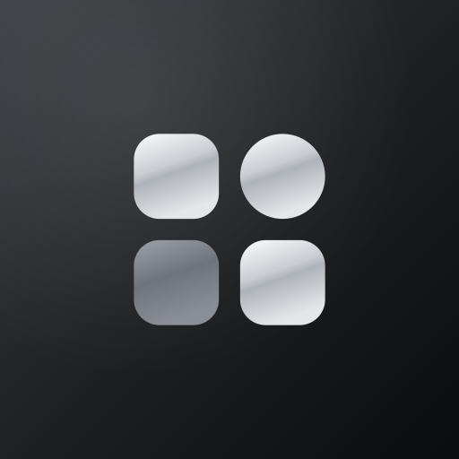

# Plain Launcher

An open-source, ad-free, stock-Android-style home screen for Android 8 and newer, made first for
Xiaomi / Redmi (MIUI) phones. It comes with **Ad Shield**, a reversible PC script that switches
off the system apps that serve ads on MIUI and Realme.

## What it does
- Home screen with pages, a 5-slot dock, folders, drag-and-drop and Android widgets
- Swipe-up app drawer with instant search and an A-Z scroller
- Date, weather (Open-Meteo, no key) and your real next alarm. Tap them to open the phone's Weather / Clock app
- **Steps page** (swipe right on the first home page): today against a goal, distance, active time,
  calories, an hourly chart and a 7/30-day history
- **Send walks to Health Connect**, so apps like MyNetDiary count your walking as exercise
- Icon shapes (circle / squircle / rounded square), icon packs, themed app icon on Android 13+
- Swipe down for notifications, double-tap to lock, notification dots, hidden apps
- No ads, no analytics, no accounts. Nothing leaves the phone except the weather request.

## Which phones
Android 8.0 (API 26) to Android 16 (API 36). Built and tested on a Redmi Note 7 (MIUI 12.5, Android 10);
other phones are covered by code, not yet by hands-on testing. Reports are welcome.

| Feature | Xiaomi / Redmi / POCO | Other phones |
|---|---|---|
| Home, drawer, widgets, icon packs | Yes | Yes |
| Steps | MIUI's own step history (same data as App Vault) | Health Connect (Samsung Health, Fit, Android 14+…) if you allow it, otherwise the phone's step sensor, recorded in the background from the day you turn it on |
| Send walks to Health Connect | Yes | Yes (with the step sensor source) |
| Weather / Clock tap targets | MIUI Weather, MIUI Clock | The phone's own Weather / Clock app when it has one |
| Ad Shield lists | MIUI (tested) | Realme (untested), others: none yet |

Choose the step source in Home settings › Step source. Health Connect is a Play Store app on
Android 9-13 and part of the system on Android 14+.

Known limits, shared by every third-party launcher: Recents and the gesture-navigation animations
stay the phone maker's. Some older MIUI and ColorOS versions don't allow full-screen gestures with a
third-party launcher (use the 3-button bar there).

## Install
Download the APK from the GitHub release, open it on the phone and allow installing from your
browser or file manager. Then set it as the home app (it offers this on first start).

## Build
JDK 17+ (this repo points Gradle at `/usr/lib/jvm/jdk-20`; change `gradle.properties`) and the
Android SDK with platform 36.

    ./gradlew testDebugUnitTest lintDebug assembleDebug
    # APK: app/build/outputs/apk/debug/app-debug.apk

MIUI blocks `adb install` unless "Install via USB" is on (that needs a Mi account). Otherwise copy
the APK to the phone and tap it.

## Ad Shield (PC script)
Run with the phone connected and USB debugging on:

    cd adshield
    ./adshield.sh detect
    ./adshield.sh apply              # dry run: shows what would change
    ./adshield.sh apply --bloat --yes
    ./adshield.sh restore --yes      # undo exactly what apply did
    ./adshield.sh dns on             # optional ad-blocking Private DNS

Nothing is uninstalled; packages are only disabled for your user. Core system packages are on a
protected list (`lists/protected.txt`) and are never touched. The Realme list is untested on real hardware.

### Switches only the UI can turn off (MIUI)
- Settings › Passwords & security › Privacy › Ad services › Personalized ad recommendations: off
- Security app, Themes, File Manager, Downloads and the package installer: Settings › recommendations: off

## Not done yet
A Samsung Ad Shield list, Shizuku-based one-tap Ad Shield inside the app, drawer categories,
a calculator in search, and a signed release build for the Play Store.

License: Apache-2.0
